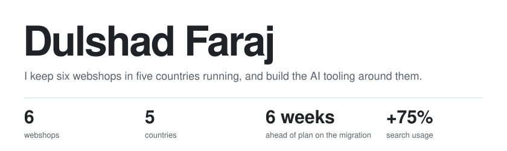
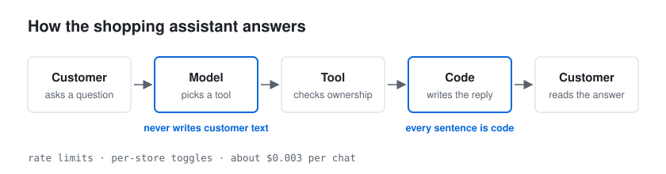

<picture>
  <source media="(prefers-color-scheme: dark)" srcset="assets/header-dark.svg">
  
</picture>

Senior Engineer at Keesing Media Group, Amsterdam. Magento 2, Hyvä, and a
growing amount of LLM plumbing.

### Things I've come to believe

**An LLM shouldn't talk to your customers.**
In the shopping assistant I built, the model only picks which tool to call.
Every sentence a customer reads is written by code.

<picture>
  <source media="(prefers-color-scheme: dark)" srcset="assets/assistant-dark.svg">
  
</picture>

**Standards belong in tooling, not in someone's head.**
Our PR review, ticket refinement and release steps are skills that any
developer or agent can run. A bug now takes a median of 8 days from report
to fix, down from 30.

**An alert you haven't backtested is a guess.**
The order-drop alerts on our monitoring console were replayed against
13 months of real orders before they went live.

**The best migration is the one nobody notices.**
Six shops moved from an agency to in-house hosting six weeks ahead of plan.
Search moved from paid modules to Elasticsearch with no SEO loss.

### Ask me about
- Using AI effectively inside a team's delivery process
- Putting team standards into tooling so a new developer is up to speed in a month
- Bringing a platform back in-house from an agency
- Monitoring that answers business questions, not server questions

Most of my code lives in private repos. [LinkedIn](https://www.linkedin.com/in/dulshad-faraj/)
